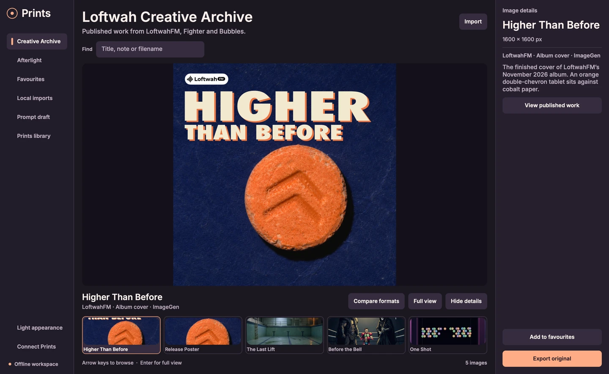

# Prints Desktop

**Pick the version worth keeping.**

**TL;DR** · Drop in a few exports or AI variants, compare them side by side and take the exact original with you. Prints works offline without an account. Connect your own Oyster library to browse and export generated work.

[Try the browser demo](https://prints.loftwah.com/#afterlight) · [Download the desktop preview](https://github.com/loftwah/prints-desktop/releases/tag/v0.5.1) · [Contribute](CONTRIBUTING.md)

## Quickstarts

- **Desktop.** [Download the matching archive](https://github.com/loftwah/prints-desktop/releases/tag/v0.5.1) and [open Prints](https://prints.loftwah.com/guide#install). In **Creative Archive**, pick **Higher Than Before**, choose **Compare formats**, then return to the contact sheet and choose **Export original**.
- **Build from GitHub.** Install [Rust with rustup](https://rustup.rs/) and check the [platform prerequisites](CONTRIBUTING.md#platform-setup). Clone the release tag and run the locked build.

  ```sh
  git clone --branch v0.5.1 --depth 1 https://github.com/loftwah/prints-desktop.git
  cd prints-desktop
  cargo run --locked
  ```

- **Agent.** Connect your approved client to your Oyster host’s `/mcp` endpoint. Use a revocable App key with `apps.read` for the Prints installation and a selected Computer and library folder. Ask the agent to list up to five outputs and report their formats and any available dimensions without downloading them. [Fungi’s read-only example](https://docs.fungi.computer/guides/call-an-app-from-your-own-server) · [Prints connection notes](docs/oyster.md)



*Prints Desktop v0.4.0 on macOS, with published artwork from the [Loftwah Creative Archive](assets/archive/README.md).*

## Pick a starting point

| If you want to… | Start here |
| --- | --- |
| **See what the UI does** | Open the [creative archive in your browser](https://prints.loftwah.com/#archive). Follow the [native walkthrough](https://prints.loftwah.com/#walkthrough) to compare **Higher Than Before** and export an original. |
| **Work offline** | Download the preview and drop up to 300 JPEG, PNG or WebP originals into the workspace. Choose **Set first image**, select another original and choose **Compare images**. The offline library needs no account, wallet, token, or model credits. |
| **Resume a draft** | Choose **Keep with draft** in each image’s details. Open **Prompt draft** and write your brief. Prints saves it with the shortlist as you work. |
| **Browse an Oyster library in the app** | Open **Connect Prints** and use a scoped App key for your installation. [Desktop connection steps](docs/oyster.md) |
| **Use Shiitake** | Open Shiitake in your project folder and give it the release art brief below. For your first tool call, use your own authorised Fungi Team or Oyster connection. [Shiitake terminal guide](https://docs.fungi.computer/guides/use-the-terminal) |
| **Build with AI** | Start with one brief and one target size. Create through web Prints, then inspect the resulting file in the desktop app. [Open Prints and choose a prompt](https://prints.loftwah.com/) |
| **Run the stack yourself** | Start with the free local Oyster trial. Add an authorised Workers AI model when you need generation and use AI Gateway when you need to observe supported requests. [Oyster trial](https://docs.fungi.computer/oyster-quickstart) · [Prints on Cloudflare](https://docs.fungi.computer/apps/prints) |

### Try a real brief

Use this in your agent or image tool. In the desktop app, **Prompt draft** is a local place to work on the text.

```text
Make a 4:5 release poster for an imaginary indie game called Night Shift.
Show one orange desk lamp illuminating a tiny coastal town built from paper.
Use warm orange, deep ink and off-white, with a single point of focus.
Set only the words NIGHT SHIFT. Keep the letters readable at 300 pixels wide.
Return one version. Keep the original image and save the prompt with it.
```

If you already have a scoped Oyster connection, this is a useful first agent request.

```text
Use the approved Oyster connection to list Prints outputs. Tell me which
images are portrait and which are square, using the metadata already returned.
Keep this read-only. Ask me to select an output before exporting anything.
```

The desktop app reads compatible Oyster libraries and hands creation off to signed-in web Prints. Hosted generation requires model access and funding. [Connection and permission details](docs/oyster.md) · [Native creation status](https://github.com/loftwah/prints-desktop/issues/6)

Prints saves a working draft after a short pause in editing and flushes pending
changes on normal close. After a crash or forced quit, the last completed save
is available. The editor shows when a save fails so you can retry. **Undo clear**
recovers the most recent cleared brief, including after reopening.

## Get the preview

Get the archives, SHA-256 checksums and platform verification details from the [v0.5.1 release](https://github.com/loftwah/prints-desktop/releases/tag/v0.5.1).

| Platform | Run it | Verified |
| --- | --- | --- |
| **Apple Silicon Mac** · macOS 14+ | Extract the ZIP and open `Prints Desktop.app`. [Gatekeeper guidance](https://support.apple.com/en-au/102445) | Ad-hoc signed and unnotarised. See the release for the Mac checks on this build. |
| **Linux** · x64 or ARM64 | Extract the tarball and run `prints-desktop` in a graphical session. [Runtime prerequisites](CONTRIBUTING.md#platform-setup) | See the release for Debian graphical verification and x64 translation coverage. |
| **Windows** · x64 | Extract the ZIP and open `Prints Desktop.exe`. | Unsigned x64 cross-build. Archive and embedded source checks passed. A Windows desktop launch is unverified. |

If Gatekeeper blocks the Mac ZIP, build the `v0.5.1` tag with the free Xcode command-line tools and Rust, or try the contact sheet in your browser. A local build needs no Apple Developer Program membership. [Install guide and exact build commands](https://prints.loftwah.com/guide#install)

[Windows desktop verification](https://github.com/loftwah/prints-desktop/issues/7) · [Public download counts](https://prints.loftwah.com/downloads) · [v0.4.1 benchmark baseline](docs/preview-benchmark.md)

## Build or help

Install [Rust with rustup](https://rustup.rs/), check the [platform setup](CONTRIBUTING.md#platform-setup), then run:

```sh
git clone https://github.com/loftwah/prints-desktop.git
cd prints-desktop
cargo run --locked
```

The app uses Rust and [Rune](https://github.com/anomalyco/rune), pinned in `Cargo.toml`. Prints runs independently. App Composer lists the project for discovery. Composer operators can enable the optional [Prints admin plugin](https://github.com/loftwah/app-composer/blob/main/docs/prints-integration.md).

**First contribution:** Try comparison or local import with a public image and tell us the exact point where you hesitate. Include your platform, release, and the steps you took. A reproducible observation or a small docs fix is useful on its own.

[Contribution guide](CONTRIBUTING.md) · [Open an issue](https://github.com/loftwah/prints-desktop/issues/new/choose) · [Product direction](PRODUCT.md) · [App Composer project](https://composer.loftwah.com/prints-desktop) · [MIT licence](LICENSE)
